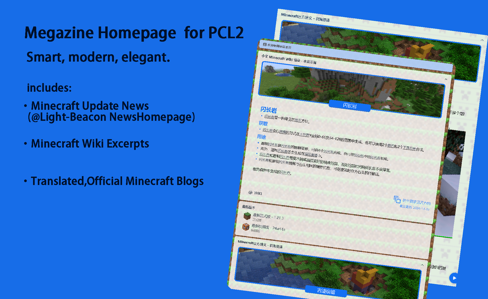

# Megazine Homepage for PCL2

***A PCL2 Homepage -- Smart,modern and elegant.***


## What is included in this homepage:

- [Minecraft Wiki](https://zh.minecraft.wiki) 特色条目摘录;
- Minecraft 版本新闻卡片（新闻数据来自 @Light-Beacon 的 API）;
- 历史上的今天（数据来自百度百科）。

## 工程结构

本主页是一个 [HomepageBuilder](https://github.com/Light-Beacon/HomepageBuilder) 工程，由构建器从工程文件生成 `output/Custom.xaml`：

```
src/Project.yml             工程入口，指定默认页面
src/pages/main.yml          页面由哪些卡片组成
src/libraries/              卡片库，一张卡片一个文件
src/resources/styles.xaml   全部样式资源
src/structures/             页面模版、卡片模版与构件
src/modules/                构建时抓取数据的脚本（Wiki / 新闻 / 历史上的今天）
src/assets/                 图标路径与鸣谢文本，构建时由 modules/page.py 插入
src/main.py                 构建入口，调用构建器并写版本号
output/Custom.xaml          构建产物
```

卡片的写法见 [HomepageBuilder 文档](https://builder.docs.bugjump.net/)。

## 本地构建

```bash
cd src
uv sync
uv run main.py
```

产物写入仓库根目录的 `output/Custom.xaml`，版本号写入 `output/Custom.xaml.ini`。也可以直接跑 `uv run builder build --project Project.yml --output-path ../output/Custom.xaml`，但版本号不会写进 ini。

## Usage:

1. Use presets  
   First, open your Plain Craft Launcher(Please use the latest version).
   Secondly, turn to `Settings` page.
   Then, turn to the `Personalization`tab on the left side.
   Next, scroll down and find the `Homepages` card and choose the `presets` selection.
   After that, select `Megazine Homepage` in the combobox below.
   Finally, reboot the launcher, you'll see the *brand new* Homepage!
2. Use Online Update Mode  
   First, follow the instructions 1 to 3 in `Use presets` section.
   Then, choose the `Online` selection.
   Next, enter `https://pclhomeplazaoss.lingyunawa.top:27000/d/Homepages/Ext1nguisher/Custom.xaml` in the entry.
   Finally, reboot the launcher.

## Acknowledgement:

- LingyunAwA (JingHai-Lingyun @Github)(1913532130 @QQ)
- Mr.Joker (Joker2184 @Github)(754284083 @QQ)
- Essdak1986 (1837750594 @QQ)
- tu_xing (2480379448 @QQ)
- Nattiden (Light-Beacon @Github)(2682645990 @QQ)

## License

- `src/`：代码与工程文件，[Apache License 2.0](LICENSE)
- `output/`：生成的主页产物，[CC BY-NC-SA 3.0](LICENSE)

***Thank you for choosing us!***
