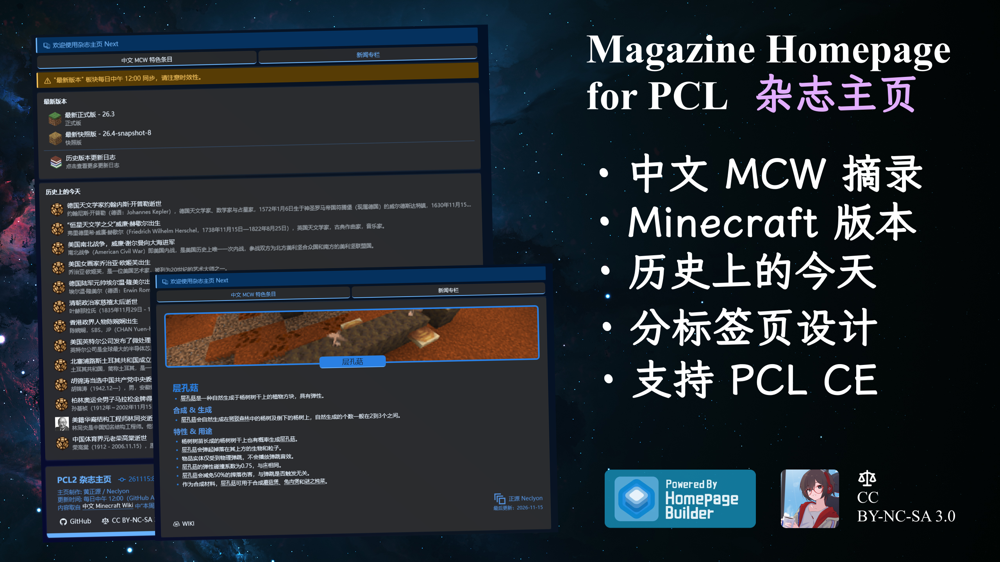

# Magazine Homepage for PCL
 
***PCL 杂志主页——简洁、效率*** 



## 内容:  
 
- [中文 Minecraft Wiki](https://zh.minecraft.wiki) 特色条目摘录； 
- Minecraft 版本新闻卡片（数据来自新闻主页 API）； 
- 历史上的今天（数据来自百度百科）。 
 
## 工程结构 
 
本主页是一个 [HomepageBuilder](https://github.com/Light-Beacon/HomepageBuilder) 工程： 
 
``` 
src/Project.yml             工程入口 
src/pages/main.yml          页面卡片 
src/libraries/              卡片库 
src/resources/styles.xaml   样式资源（部分来自新闻主页） 
src/structures/             页面模版、卡片模版与构件 
src/modules/                构建时脚本（Wiki / 新闻 / 历史上的今天） 
src/assets/                 资源文件 
src/main.py                 构建入口 
output/Custom.xaml          构建产物 
``` 
 
## 本地构建 
 
```bash 
git clone https://github.com/Neclyon/Magazine-Homepage-PCL.git 
cd src 
uv sync 
uv run main.py 
``` 
 
产物写入仓库根目录的 `output/Custom.xaml`，版本号写入 `output/Custom.xaml.ini`。 
直接运行 `uv run builder build --project Project.yml --output-path ../output/Custom.xaml`时，请注意版本号不会被写入。 
 
## 使用指导 
 
- 使用预设（仅官方 PCL）   
  1. 打开 PCL 启动器（请更新至最新版本）。 
  2. 转到“设置”-“个性化”页面。 
  3. 下滑，在“主页”卡片选择“预设”。 
  4. 在多选框内，选择杂志主页。 
  5. 回到启动页即可看到杂志主页。 
 
- 使用联网更新（兼容 PCL CE） 
  1. 打开启动器。 
  2. 转到“设置”-“个性化”页面。 
  3. 下滑，在“主页”卡片选择“联网更新”。 
  4. 在地址栏内输入以下地址： 
  ``` 
  https://gh-proxy.com/https://github.com/Neclyon/Magazine-Homepage-PCL/raw/main/output/Custom.xaml 
  ``` 
  5. 回到启动页即可看到杂志主页。
 
## 鸣谢： 
 
- LingyunAwA (JingHai-Lingyun @Github)(1913532130 @QQ) 
- Mr.Joker (Joker2184 @Github)(754284083 @QQ) 
- Essdak1986 (1837750594 @QQ) 
- tu_xing (2480379448 @QQ) 
- Nattiden (Light-Beacon @Github)(2682645990 @QQ) 
 
## License 
 
- `src/`：代码与工程文件，[Apache License 2.0](LICENSE) 
- `output/`：生成的主页产物，[CC BY-NC-SA 3.0](LICENSE) 
 
***感谢使用。请给仓库点颗 Star，谢谢。*** 
